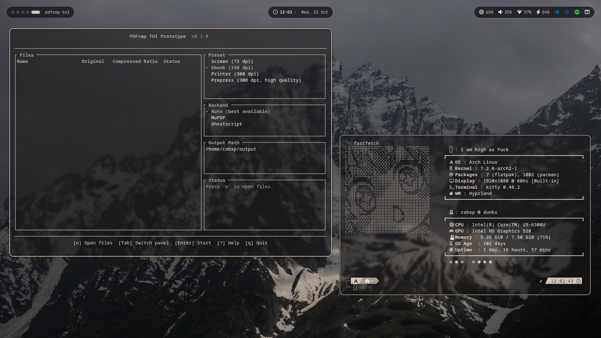

# PDF Compressor (`pdfcmp`)

A lightweight PDF compressor for Linux, built with Rust, Ghostscript, and MuPDF. Designed to reduce PDF file sizes through a straightforward command-line interface.



## Quick Start

```bash
# Compress a PDF using the default preset
pdfcmp document.pdf

# Compress aggressively for screen viewing
pdfcmp document.pdf -p screen

# Specify the output file
pdfcmp large.pdf -o small.pdf -p ebook

# Compress PDFs in a directory
pdfcmp ~/Documents -r

# Allow overwriting existing output files
pdfcmp document.pdf -f
```

## Installation

### Build from Source

**Requirements:** Rust toolchain and the dependencies required to build the MuPDF backend.

```bash
git clone https://github.com/cabxxx21/PDFcmp.git
cd PDFcmp
cargo install --path cli
```

Ghostscript is recommended for stronger image compression. Install it using your distribution's package manager.

```bash
# Arch Linux
sudo pacman -S ghostscript

# Ubuntu / Debian
sudo apt install ghostscript

# Fedora
sudo dnf install ghostscript

# Alpine Linux
sudo apk add ghostscript
```

Make sure Cargo's binary directory is included in your `PATH`.

```bash
export PATH="$HOME/.cargo/bin:$PATH"
```

## Project Structure

```text
PDFcmp/
├── cli/
│   ├── src/
│   │   ├── args.rs
│   │   ├── batch.rs
│   │   ├── main.rs
│   │   └── output.rs
│   └── Cargo.toml
├── core/
│   ├── src/
│   │   ├── backend/
│   │   │   ├── ghostscript.rs
│   │   │   ├── mod.rs
│   │   │   └── mupdf.rs
│   │   ├── error.rs
│   │   ├── lib.rs
│   │   ├── options.rs
│   │   ├── stats.rs
│   │   └── util.rs
│   └── Cargo.toml
├── tui/
│   ├── src/
│   │   ├── app.rs
│   │   ├── main.rs
│   │   ├── types.rs
│   │   └── ui.rs
│   └── Cargo.toml
├── tests/
│   └── integration.rs
├── .gitignore
├── Cargo.lock
├── Cargo.toml
├── LICENSE
├── README.md
├── build-release.sh
└── install.sh
```

## Features

- **Simple CLI:** Compress PDFs without complicated subcommands.
- **Multiple backends:** Choose between Ghostscript and MuPDF.
- **Compression presets:** Four presets for different quality and size requirements.
- **Automatic mode selection:** Handles individual files and directories.
- **Batch processing:** Process multiple PDFs in one operation.
- **Parallel execution:** Configure the number of concurrent jobs.
- **Output protection:** Existing files are preserved unless `--force` is specified.
- **Compression statistics:** Display file sizes, savings, and processing duration.
- **JSON output:** Produce machine-readable results for scripts.

## Compression Presets

| Preset | Intended Use |
|---|---|
| `screen` | Smaller files for screen viewing |
| `ebook` | Balanced size and quality for e-readers |
| `printer` | Higher quality for everyday printing |
| `prepress` | Quality-focused output for professional printing |

The default preset is `ebook`.

Actual compression results depend on the PDF's contents. Image-heavy documents may shrink considerably, while text-heavy or already-optimized PDFs may show little improvement.

## Usage

### Compress a Single PDF

```bash
# Use the default preset
pdfcmp report.pdf

# Reduce file size more aggressively
pdfcmp report.pdf -p screen

# Use higher-quality settings
pdfcmp report.pdf -p printer

# Choose a custom output filename
pdfcmp report.pdf -o report_small.pdf
```

### Batch Processing

```bash
# Process PDFs in a directory
pdfcmp ~/Documents

# Include subdirectories
pdfcmp ~/Documents -r

# Specify an output directory
pdfcmp ~/PDFs -o ~/CompressedPDFs -r

# Limit parallel jobs
pdfcmp ~/Documents -j 4
```

### Choose a Backend

```bash
# Automatically select a backend
pdfcmp document.pdf -b auto

# Use Ghostscript
pdfcmp document.pdf -b ghostscript

# Use MuPDF
pdfcmp document.pdf -b mupdf
```

### Additional Options

```bash
# Overwrite existing output files
pdfcmp document.pdf -f

# Enable verbose logging
pdfcmp document.pdf -v

# Output results as JSON
pdfcmp document.pdf --json

# Continue processing after errors in batch mode
pdfcmp ~/Documents -r --continue-on-error
```

## TUI (Terminal User Interface)

The `pdfcmp-tui` binary provides an interactive terminal interface for compressing PDFs.

### Installation

```bash
# Build with default tinyfiledialogs picker (portable, no GTK dependency)
cargo install --path tui

# Or build with native GTK dialog (requires GTK development libraries)
cargo install --path tui --features native-dialog
```

### Usage

```bash
# Launch TUI, then press 'o' to select PDF files
pdfcmp-tui

# Pre-load files from command line
pdfcmp-tui file1.pdf file2.pdf

# Pre-load files from directory
pdfcmp-tui ~/Documents/*.pdf
```

### Key Bindings

| Key | Action |
|-----|--------|
| `↑` `↓` | Navigate file list |
| `Tab` / `Shift+Tab` | Switch focus (Files → Preset → Backend → Output) |
| `Enter` | Start compression |
| `o` | Open file picker (multi-select) |
| `Space` | Toggle file selection |
| `c` | Cancel running compression |
| `h` | Toggle help panel |
| `q` / `Esc` | Quit |

### Features

- **Multi-file selection** — Add/remove PDFs interactively
- **Real-time compression** — Files compressed in background thread; UI stays responsive
- **Live status** — Per-file progress, compressed size, and savings ratio in table
- **Auto backend** — Automatically picks best available (Ghostscript preferred, falls back to MuPDF)
- **Portable file picker** — Uses `tinyfiledialogs` by default (no heavy desktop dependencies); optional `rfd` native dialogs via `--features native-dialog`

## Compression Results

Compression performance varies depending on image resolution, embedded fonts, existing compression, and document structure.

Tests on sample PDFs have demonstrated file-size reductions ranging from approximately 26% to 88%. These are results from individual test files, not guaranteed results for every document.

Always inspect the output document to ensure that its visual quality remains suitable for your needs.

## How It Works

`pdfcmp` provides a command-line interface backed by a Rust core library.

The CLI handles user input and batch processing, while the core library manages compression options, backend selection, error handling, and statistics.

### Ghostscript Backend

Ghostscript is recommended for image-heavy documents. It can downsample and recompress images while rewriting the PDF.

- Runs through the `gs` command.
- Supports image downsampling and recompression.
- Must be installed separately.

### MuPDF Backend

MuPDF provides an alternative backend for PDF optimization.

- Integrated through Rust bindings.
- Performs PDF optimization and stream compression.
- Build-time requirements depend on the library configuration.

Compression effectiveness varies by document and backend.

## Safety Features

- Original input files are not intentionally modified.
- Output files use a temporary-file workflow.
- Failed operations attempt to clean up incomplete output.
- Existing output files are protected unless `--force` is used.
- Encrypted PDFs that the application cannot process are rejected with an error.

## Command Reference

### CLI (`pdfcmp`)

```text
Usage: pdfcmp [OPTIONS] <PATH>

Arguments:
  <PATH>                  Input PDF file or directory

Options:
  -o, --output <PATH>     Output file or directory
  -p, --preset <PRESET>   Compression preset
                          [screen|ebook|printer|prepress]
  -b, --backend <BACKEND> Backend selection
                          [auto|mupdf|ghostscript]
  -f, --force             Overwrite existing output files
  -r, --recursive         Process subdirectories recursively
      --suffix <SUFFIX>   Output suffix for batch mode
  -j, --jobs <N>          Maximum number of parallel jobs
      --continue-on-error Continue after errors in batch mode
      --json               Output results as JSON
  -v, --verbose           Enable verbose logging
  -h, --help              Print help information
```

### TUI (`pdfcmp-tui`)

```text
Usage: pdfcmp-tui [FILES]...

Arguments:
  [FILES]...              Optional PDF files to pre-load

Keys:
  ↑/↓           Navigate file list
  Tab           Next panel (Files → Preset → Backend → Output)
  Shift+Tab     Previous panel
  Enter         Start compression
  o             Open file picker (multi-select)
  Space         Toggle file selection
  c             Cancel compression
  h             Toggle help
  q / Esc       Quit
```

Run `pdfcmp --help` or `pdfcmp-tui --help` to see options supported by your installed version.

## Limitations

- Does not perform OCR on scanned documents.
- Does not remove passwords or bypass PDF encryption.
- Does not flatten interactive PDF forms.
- Compression effectiveness varies by document.
- Parallel processing applies across files in batch mode, rather than necessarily speeding up an individual file.
- Aggressive compression presets may reduce visual quality.

## License

This project is licensed under the MIT License. See [LICENSE](LICENSE) for details.

Third-party dependencies retain their respective licenses. See the relevant project documentation for details about Ghostscript and MuPDF licensing and distribution requirements.

## Credits

- **Ghostscript:** PDF writing and image compression.
- **MuPDF:** PDF parsing and optimization.
- **mupdf crate:** Rust bindings for MuPDF.
- **clap:** Command-line argument parsing.
- **rayon:** Parallel batch processing.

## Contributing

Contributions, bug reports, and suggestions are welcome.

1. Fork the repository.
2. Create a feature branch.
3. Make your changes and add tests where appropriate.
4. Run `cargo test --workspace`.
5. Submit a pull request.

## Changelog

### 0.2.0

- Added TUI (`pdfcmp-tui`) with interactive file picker, real-time compression, and live status table
- Added `tinyfiledialogs` file picker (portable, no GTK required); optional native GTK dialog via `native-dialog` feature
- FIxed auto backend selection (Ghostscript preferred, falls back to MuPDF)

### 0.1.0

- Initial CLI release.
- Added Ghostscript and MuPDF backends.
- Added four compression presets.
- Added single-file and batch processing.
- Added parallel batch execution.
- Added output safety checks and compression statistics.
- Added JSON output and status reporting.
